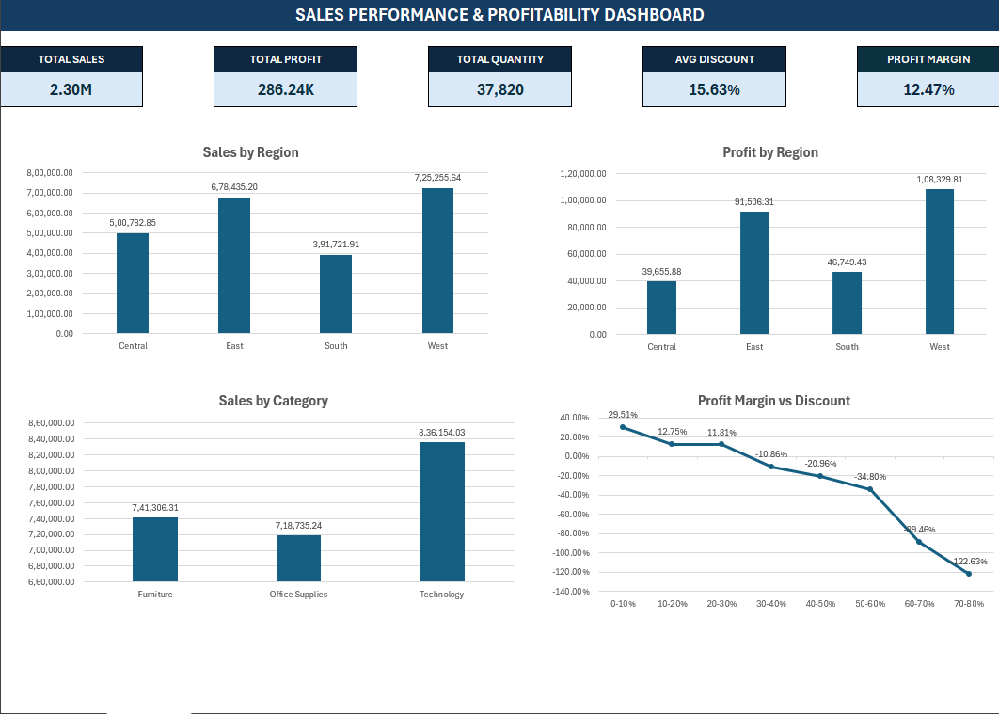
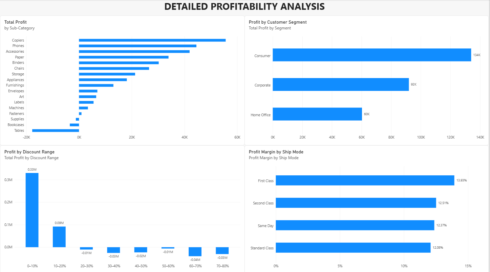

# Sales Performance, Profitability & Discount Analysis

An end-to-end sales analytics project using **Microsoft Excel** and **Power BI** to analyze sales performance, profitability, discounts, regions, product categories, customer segments, and shipping methods.

## Project Overview

The goal of this project is to turn raw sales data into meaningful insights through data cleaning, exploratory analysis, KPI tracking, and interactive dashboards.

## Tools & Technologies

- **Microsoft Excel:** Data cleaning, analysis, KPI calculations, charts, and dashboard creation
- **Power Query:** Data transformation and preprocessing
- **Power BI:** Interactive dashboards, data visualization, and DAX measures
- **DAX:** KPI calculations and profitability metrics

## Project Workflow

1. Inspected the raw sales dataset.
2. Cleaned and prepared the data for analysis.
3. Performed exploratory data analysis in Excel.
4. Built an Excel dashboard to summarize key performance indicators and trends.
5. Developed an interactive Power BI report with sales overview and detailed profitability pages.
6. Used slicers to explore results across regions, categories, customer segments, and shipping modes.

## Key Performance Indicators

- Total Sales
- Total Profit
- Total Quantity
- Average Discount
- Profit Margin

## Dashboard Previews

### Excel Dashboard



### Power BI — Sales Overview


### Power BI — Profitability Analysis



## Key Areas of Analysis

- Sales and profit by region
- Sales and profit by product category
- Profitability by sub-category
- Profit by discount range
- Profit margin by shipping mode
- Sales and profit across customer segments
- Relationship between discount levels and profitability

## Project Structure

```text
data analyst project/
├── data/
│   ├── raw_dataset.csv
│   └── sales_data.csv
├── excel/
│   └── Excel analysis and dashboard workbook
├── powerbi/
│   └── Sales-Performance-Analysis.pbix
├── screenshots/
│   ├── excel-dashboard.png
│   ├── sales-overview.png
│   └── profitability-analysis.png
└── README.md
```

*Note: Replace the example dataset filenames and report filename above with the actual filenames in your folders before publishing.*

## Key Findings

- The West region has the strongest overall sales performance in the current analysis.
- Technology contributes the highest sales and profit among the three main product categories.
- Profitability varies considerably across sub-categories, with some sub-categories generating losses.
- Higher discount ranges are associated with weaker profitability in this dataset.

These findings describe patterns in the analyzed data and do not, by themselves, establish causation.

## How to Explore

1. Open the Excel workbook to explore the analysis and dashboard.
2. Open the Power BI `.pbix` file using Power BI Desktop.
3. Use the report slicers to filter the results by region, category, customer segment, and shipping mode.

## Notes

The raw dataset is retained separately from the cleaned dataset to document the preprocessing workflow. Dataset attribution and redistribution permissions should be included where applicable.